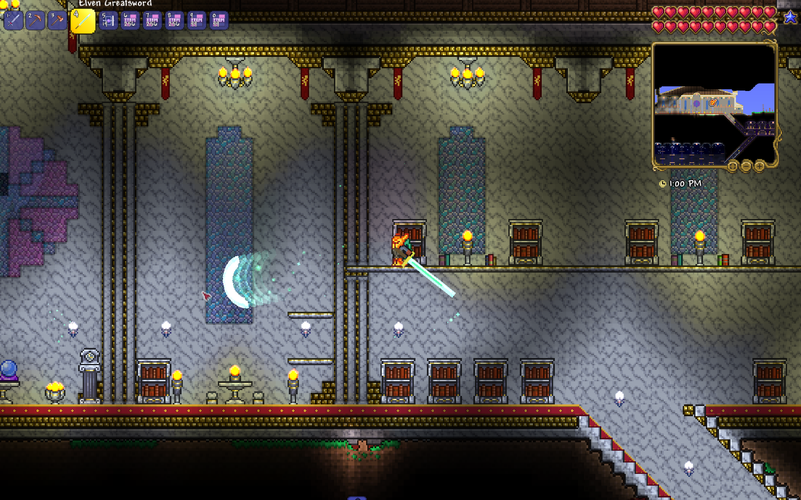
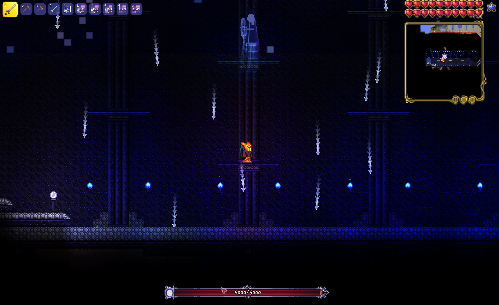

# Terraria: Reign of the Ancients

A tModLoader content mod (Terraria 1.4.4) set in a world of fallen civilizations, vengeful gods, and the Great Ones who broke them all. Each **Reign** is a self-contained expansion with its own enemies, boss, items and biomes, spread across the progression.

| Elven Greatsword magic slash | Lower hall of the generated Mystical Library |
|---|---|
|  |  |

**Built with:** C#, tModLoader, Terraria 1.4.4

## Technical highlights

- **Custom enemy AI as state machines.** Each enemy runs its own state machine with telegraphed attacks, so players can read and dodge them.
- **Procedural world generation.** A custom generation pass places the Mystical Library during world creation. It searches for a valid forest site (flat ground, distance from spawn and world edges) and builds the structure. The layout is saved with the world and synced to multiplayer clients, so later content like the Volodar boss can find the arena.
- **Custom biome and spawn rules.** The Mystical Library is a biome with its own enemy spawn pool.
- **Hybrid melee/magic damage class.** The Elven Greatsword swings normally, and a right click sends out a mana-costing magic slash that scales with both melee and magic damage.

## Planned progression

| Stage | Reign | Boss |
|---|---|---|
| Pre-Hardmode (after Evil boss) | Elves | Volodar |
| Pre-Hardmode (after Skeletron) | Dwarves | Dwarven Titan |
| Pre-Hardmode | Skrougers | Boulder Drake |
| Early/Mid Hardmode | Murks | Irwhyal |
| Late Hardmode | Giants | Obdgar, the Mountainsplitter |
| Post-Moon Lord | Old Gods, Great Ones | TBD |

## Current status: Reign of the Elves

Enemies for the **Mystical Library** biome:

- **Elven Apprentice:** floating mage that keeps its distance and fires slow fireballs.
- **Elf Squire:** melee walker.
- **Elf High-Guard:** armored greatsword user with a telegraphed windup → lunge → slide state machine and a custom reach hitbox.
- **Elven Archmage:** floating caster that alternates between a 3-way arcane spread and a telegraphed instant-hit beam. It teleports to safe, open spots with line of sight to the player, and teleports sooner when it loses sight of them.

Items: **Elven Greatsword** (melee swing + right-click magic slash).

## Roadmap

- [x] Mystical Library structure, biome and spawn conditions
- [x] Elven enemies (Apprentice, Squire, High-Guard, Archmage)
- [ ] Volodar boss fight and signature bow
- [ ] High-Guard greatsword drop and other loot
- [ ] Dwarves, Skrougers, Murks

## Building

Clone into `Documents/My Games/Terraria/tModLoader/ModSources/`, then open tModLoader → Workshop → Develop Mods → Build + Reload.
