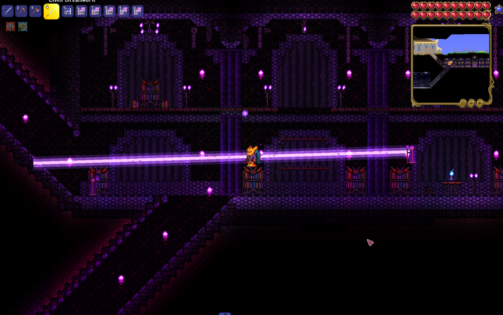

# Terraria: Reign of the Ancients

A tModLoader content mod (Terraria 1.4.4) set in a world of fallen civilizations, vengeful gods, and the Great Ones who broke them all. Each **Reign** is a self-contained expansion with its own enemies, boss, items and biomes, spread across the progression.

| Volodar boss fight: arrow rain in the throne room | Elven Greatsword magic slash |
|---|---|
|  |  |

**Built with:** C#, tModLoader, Terraria 1.4.4

## Technical highlights

- **A full two-phase boss fight.** Volodar, the mage-archer ruler of the Mystical Library, has ten attacks driven by a state machine and is multiplayer-safe: the server picks attacks and spawns projectiles, and state syncs to clients.
- **Custom enemy AI as state machines.** Each enemy runs its own state machine with telegraphed attacks, so players can read and dodge them.
- **Procedural world generation.** A custom generation pass places the Mystical Library during world creation. It searches for a valid forest site (flat ground, distance from spawn and world edges) and builds the structure. The layout is saved with the world and synced to multiplayer clients, so later content like the Volodar boss can find the arena.
- **Custom biome and spawn rules.** The Mystical Library is a biome with its own enemy spawn pool.
- **Mod integration.** Volodar is registered with the Boss Checklist mod when it's installed.
- **Hybrid melee/magic damage class.** The Elven Greatsword swings normally, and a right click sends out a mana-costing magic slash that scales with both melee and magic damage.

## Planned progression

| Stage | Reign | Boss |
|---|---|---|
| Pre-Hardmode (after Evil boss) | Elves | Volodar |
| Pre-Hardmode (after Skeletron) | Dwarves | Dwarven Titan |
| Pre-Hardmode | Skrougers | Boulder Drake |
| Early/Mid Hardmode | Murks | Irwhyal |
| Late Hardmode | Giants | Obdgar, the Mountainsplitter |
| Post-Moon Lord | Old Gods, Great Ones | TBD |

## Current status: Reign of the Elves

### Boss: Volodar

Summoned with the **Sealed Tome** (crafted from Elven Essence, dropped by the library's elves) in the throne room of the Mystical Library.

- **Phase 1 (archer):** aimed volleys, arrow rain, a telegraphed piercing shot, homing magic arrows and rune arrows that lob down around the player.
- **Phase 2 (below 50% health):** adds splitting arrows, explosive orbs, a sweeping beam and spectral archer clones. Volleys and rain get denser, and elf guards march in through the entrance.
- A barrier seals the throne room doorway during the fight.
- **Drops:** Volodar's Bow (every third shot fires an arcane arrow that splits into homing shards) or Volodar's Grimoire (arcane orbs that explode into homing shards), the Spectral Sigil accessory (Expert, summons a spectral archer when you fire a ranged weapon), plus a treasure bag, trophy, Master Mode relic and mask.

### Enemies

- **Elven Apprentice:** floating mage that keeps its distance and fires slow fireballs.
- **Elf Squire:** melee walker.
- **Elf High-Guard:** armored greatsword user with a telegraphed windup → lunge → slide state machine and a custom reach hitbox.
- **Elven Archmage:** floating caster that alternates between a 3-way arcane spread and a telegraphed instant-hit beam. It teleports to safe, open spots with line of sight to the player, and teleports sooner when it loses sight of them.

Weapons: **Elven Greatsword** (melee swing + right-click magic slash).

## Roadmap

- [x] Mystical Library structure, biome and spawn conditions
- [x] Elven enemies (Apprentice, Squire, High-Guard, Archmage)
- [x] Volodar boss fight, summon item and drops
- [ ] High-Guard greatsword drop and other loot
- [ ] Dwarves, Skrougers, Murks

## Building

Clone into `Documents/My Games/Terraria/tModLoader/ModSources/`, then open tModLoader → Workshop → Develop Mods → Build + Reload.
